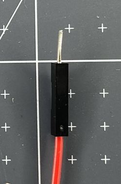
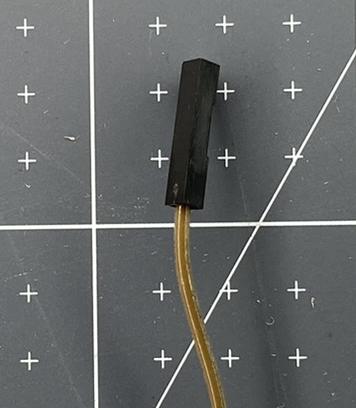

Los cables puente se usan para llevar la corriente eléctrica entre componentes electrónicos. Se usan para crear prototipos de proyectos porque te permiten conectar y desconectar componentes sin necesidad de soldar (crear conexiones más permanentes al derretir metal).

Hay tres tipos diferentes de cables puente:

+ receptáculo-receptáculo
+ pin-receptáculo
+ pin-pin

Cada tipo se reconoce por los conectores que tiene en los extremos del cable.

### El pin

Un extremo con pin tiene una pequeña pieza de metal que sobresale de la cubierta de plástico negro. Este pin se puede insertar en un receptáculo o en una placa de pruebas.

### El receptáculo

El extremo con receptáculo parece una pequeña pieza de plástico negro. Tiene un orificio donde puedes insertar el pin de un cable puente o las patitas de otros componentes eléctricos.

### Compra de cables puente

Al comprar cables puente, puedes notar que se llaman macho-macho (m-m), hembra-hembra (f-f) y macho-hembra (m-f). Estos son términos antiguos (usados antes) para describir los extremos de los cables. **Pin** y **receptáculo** son términos más inclusivos que ahora se deben usar para describir los cables puente. 